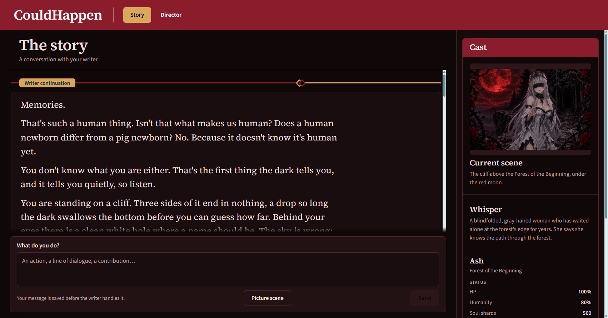
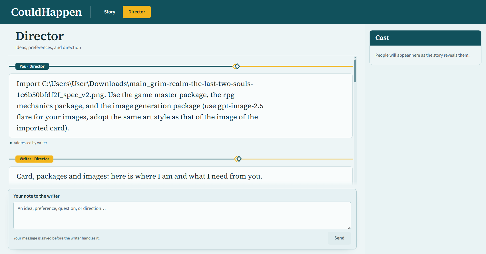
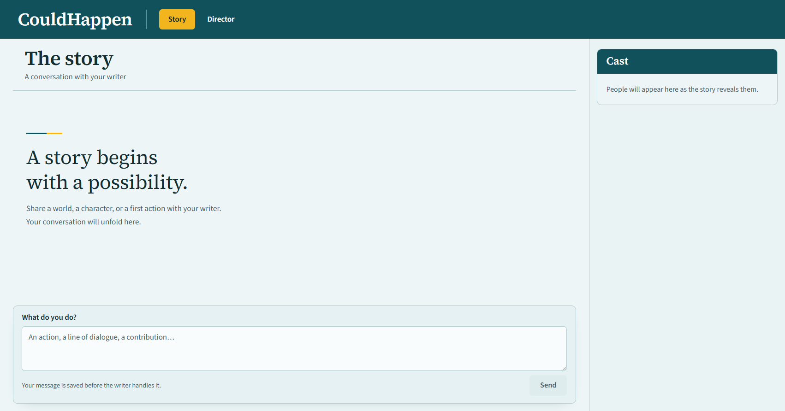

# CouldHappen

CouldHappen turns your existing coding agent into a storyteller and game master, with a browser UI built for play. You play your character and the writer handles everyone else, develops the world, remembers what happens, and lets your choices have consequences.

Open the folder with your agent, tell it to **set up**, and start playing.

<!-- dev-only -->
<p align="center">
  
</p>

<p align="center"><sub>A story in progress. The writer chose the theme, created the artwork, and added the stats for this particular session.</sub></p>
<!-- /dev-only -->

## What you can do

* **Play.** Speak, explore, investigate, fight, or try something the writer never anticipated. It runs the cast and the world, not just the next reply.
* **Step out of character.** The **Story** tab is for playing. The separate **Director** tab lets you discuss ideas, change preferences, tell the agent to change the UI, request corrections, or steer the story without interrupting the scene.
* **Keep a story going.** The writer maintains lasting knowledge of characters, events, secrets, and possibilities. Even a fresh agent session can pick up where the story left off.
* **Meet characters naturally.** The Cast panel follows the scene, showing characters, portraits, and descriptions when they're introduced. No spoilers from characters you haven't met.
* **Bring your favorites.** Import PNG or JSON character cards, including common SillyTavern formats. The writer adapts them to your world without forcing them into the story prematurely.
* **Make it your kind of story.** Want portraits, scene illustrations, RPG stats, or a custom theme? Your writer can add them using its available tools. Pure prose works too.
* **Undo a bad turn.** Ask the Director to roll it back using available Git checkpoints, keeping your feedback and useful improvements where possible.

<!-- dev-only -->
<p align="center">
  
  
</p>

<p align="center"><sub>Talk to the writer in Director, then live the story in Story.</sub></p>
<!-- /dev-only -->

## A writer with freedom to create

Your agent decides how to track characters, remember events, plan mysteries, manage relationships, or keep the world consistent. It can develop its own notes, systems, tools, and creative techniques as the story grows, rather than following a rigid framework.

It can even improve its own approach along the way. If a story needs something new, the writer has room to build it.

**The writer figures out how to make it work.**

## Give your writer more to work with

CouldHappen includes optional **Director packages**: ready-made starting points for capabilities you want in your story. Ask your writer to apply one, customize it, or build something entirely different.

| Package | What it adds |
|---|---|
| **[RPG Mechanics](.agents/skills/couldhappen/packages/rpg-mechanics/PACKAGE.md)** | Visible dice rolls, custom rules, stats, and optional character sheets. |
| **[Scene Images](.agents/skills/couldhappen/packages/scene-images/PACKAGE.md)** | In-story illustrations, character portraits, visual consistency, and optional themes. Requires an image provider key. |
| **[Game Master](.agents/skills/couldhappen/packages/game-master/PACKAGE.md)** | Stronger continuity, persistent memory, a living world, meaningful discovery, and deliberate pacing. |

**These packages are experimental and still need testing.** They're not locked-in systems. Your writer can freely inspect, adapt, extend, or replace them during play to better suit your story.

You can also ask the writer to create new packages of its own ([how packages are made](.agents/skills/couldhappen/packages/AUTHORING.md)). Nothing here is required to enjoy CouldHappen.

## Your agent. Your story. Your files.

CouldHappen doesn't come with an agent, a subscription, or a fixed game system. It supplies the browser, local tools, persistent story knowledge, and Git-supported recovery. Your existing agent does the writing and decides how best to run the adventure.

Everything lives in your own folder. There's no CouldHappen account or hosted story service, and you choose the agent and model you trust with your story.

The experience depends on the capabilities of your chosen agent, and support for different hosts is still experimental. See [host integrations](docs/reference-hosts.md) for details.

<!-- dev-only -->
## Development repository

This is the development and packaging repository, not a story workspace. **Do not run a durable story here.** Real stories run in a clean workspace unpacked from the release ZIP ([ADR 0001](docs/decisions/0001-separate-story-workspaces.md), [ADR 0002](docs/decisions/0002-publish-clean-release.md)). The release README is this file with the development-only blocks removed; see [Building a release](docs/setup.md#building-a-release).

* **Current state and next steps:** [implementation progress](docs/implementation-progress.md).
* **Building and smoke-testing a release:** [Building a release](docs/setup.md#building-a-release).
* **Documentation index:** [docs/README.md](docs/README.md).
* **Design:** [approved design](docs/designs/couldhappen.md), [design system](DESIGN.md), [product context](PRODUCT.md).
* **Evidence:** [validation results](docs/validation-results.md).
* **Contributing:** [CONTRIBUTING.md](CONTRIBUTING.md); agents read [AGENTS.md](AGENTS.md).

Source lives in `helpers/` (Python standard library only) and `web/` (Svelte/Vite). Opt-in native checkpoint examples live in `integrations/`. The Impeccable design hooks in `.codex/` are local development configuration: untracked, not published, and not part of the application.
<!-- /dev-only -->

## Start

> **You don't need to run these steps yourself.** Unpack the release, open the folder with your coding agent, and tell it to **set up**. It reads the writer skill, installs what is needed, starts the reader, and tells you when to open the browser. The steps below are what it does, for reference or if you prefer to do it by hand.

Prerequisites: Python 3.11+, Node 24+, npm, Git.

1. Unpack the release into a private or local directory.
2. Install the reader dependencies:

   ```bash
   cd web
   npm ci
   ```

3. Validate the empty workspace from the workspace root:

   ```bash
   python -m helpers validate --root .
   ```

4. Start the helper:

   ```bash
   python -m helpers serve --root . --frontend-origin http://127.0.0.1:5173
   ```

5. In a second terminal, start the reader:

   ```bash
   cd web
   npm run dev -- --host 127.0.0.1 --port 5173 --strictPort
   ```

6. After the helper prints its address and Vite is ready, claim the workspace:

   ```bash
   python -m helpers writer claim --root .
   ```

7. Open <http://127.0.0.1:5173>.

8. Ask your agent to read `.agents/skills/couldhappen/SKILL.md` and **set up**. It should inspect the workspace, leave a standing wait running so your browser messages reach it, and begin when you supply a world prompt or cards. Codex and opencode also find the skill in `.agents/skills/`; Claude Code finds it through `.claude/skills/couldhappen/`. Support for every host is experimental; see [host integrations](docs/reference-hosts.md).

9. After setup/claim, initialize Git in this directory and make the first baseline commit. The initialized workspace UUID belongs in that commit. Then check:

   ```bash
   python -m helpers checkpoint check --root .
   ```

The agent can do all of these steps itself when asked to set up; see [setup](docs/setup.md).

## Stop

When you are done for now, tell your agent to **close the game**, in chat or in the Director tab. It finishes what it was writing, saves a Git checkpoint, closes the workspace, and stops the reader and helper. Next time, open the folder with your agent and tell it to **set up** again; the story continues from where you left off.

## Privacy

Keep this story workspace private unless you deliberately choose to publish it. Story conversations, imports, portraits, private writer records, and Git history are part of the workspace archive. A public remote exposes them. A redacted export is not provided.

Do not add the development repository as a remote or merge its history into a story.

## License

CouldHappen is free software under the GNU Affero General Public License, version 3 or (at your option) any later version (`AGPL-3.0-or-later`). See [LICENSE](LICENSE). If you share a modified copy, including changes your writer agent made to the helper or reader, share it under the same license with its source; if you let other people use a modified copy over a network, offer them its source. The license covers the package source, not your story or imported third-party card material. Bundled fonts retain their OFL notices in `web/fonts/`; npm dependencies retain their own licenses in the installed package tree.

## Documentation

* [Setup](docs/setup.md)
* [Public contract](docs/public-contract.md)
* [Host integrations](docs/reference-hosts.md)
* [Design system](DESIGN.md)
* [Writer reentry](START_HERE.md)
* [Writer skill](.agents/skills/couldhappen/SKILL.md)
